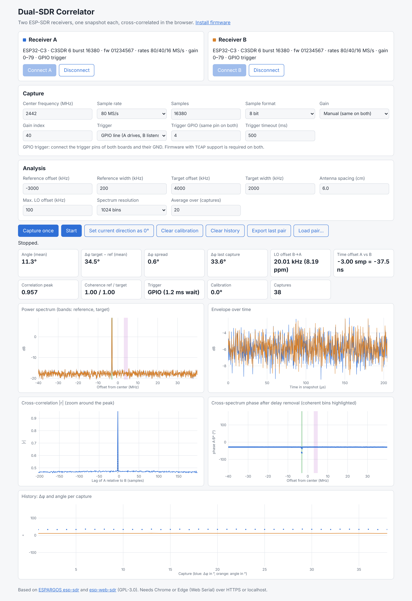

# Dual-SDR Correlator (web app)

Single-page web app that connects two ESP-SDR receivers (for example two
ESP32-C3 boards), takes one I/Q snapshot from each, and cross-correlates them:

- **LO offset (CFO)** between the two receivers, from the product A·conj(B)
- **Time offset** between the snapshots: coarse from the cross-correlation,
  refined from the cross-spectrum phase slope of wideband components
- **Phase difference per band**: a *reference* band (known transmitter) and a
  *target* band; Δφ = φ_target − φ_ref cancels the receivers' unknown LO phase
- **Angle of arrival** from Δφ, the antenna spacing and the RF frequency, with
  averaging and a "set current direction as 0°" calibration
- Export/import of a snapshot pair as JSON for offline analysis

It also contains the firmware installer (`flash.html`) with the prebuilt
ESP32-C3 firmware in `firmware/`.

<picture>
  <source media="(prefers-color-scheme: dark)" srcset="../docs/webapp-correlator-dark.png">
  
</picture>

*The screenshot shows two **emulated** receivers (a browser-side stand-in for
the firmware protocol, not real hardware): wideband noise plus a CW reference
at −3 MHz, receiver B with a 20 kHz LO offset, a 3-sample time offset and an
extra 0.6 rad (34.4°) on the reference. The app recovers the 20 kHz,
the −3 samples and Δφ ≈ 34.4° with a spread below 1° over about 30 captures.*

How to read the plots:

| Plot | What it shows |
| --- | --- |
| Power spectrum | Both receivers (blue A, orange B) with the reference (green) and target (purple) bands |
| Envelope | Signal power over the snapshot; bursts should line up in both receivers |
| Cross-correlation | Peak at the time offset between the snapshots; no clear peak means no common signal |
| Cross-spectrum phase | Phase of A·B* per frequency after removing the time offset; coherent bins are highlighted. A flat line means the time offset is removed; a step between the bands is the measured Δφ |
| History | Δφ (blue) and angle (orange) per capture |

## How the analysis works

Only the last step uses the reference and target bands. Everything before it
works on the **whole snapshot at the full bandwidth** (±40 MHz around the
center frequency at 80 MS/s). `analyze()` in `dsp.js` runs these steps for
each pair:

1. **Remove DC** from A and B.
2. **Coarse time offset and LO offset (CFO)**, over the full bandwidth.
   - Short segments of 256 samples are correlated and their magnitudes added,
     so the LO offset does not destroy the correlation. The search covers
     ±2048 samples.
   - Around that offset, the peak of FFT(a[t+k]·b*[t]) gives the LO offset
     (cross-ambiguity search).
   - B is then rotated back by the LO offset.
3. **Cross-correlation** (the *Cross-correlation* plot).
   - r[k] = Σ a[t+k]·b*[t] over all samples, without a band filter.
   - Its normalized peak is the *Correlation peak* metric (1 = identical
     snapshots), and its position is a coarse time offset.
   - Strong signals dominate it, wherever they are in the spectrum.
4. **Cross-spectrum** A·B* per frequency bin (Welch, *Spectrum resolution*
   bins; the *Cross-spectrum phase* plot).
   - The time offset is refined to about 0.1 sample from the phase slope
     across neighbouring bins.
   - Only coherent regions count: coherence ≥ 0.5 over at least 8 bins, with
     narrowband peaks masked out.
   - This is also **independent of the configured bands**: any wideband
     signal both receivers see (a Wi-Fi or BLE packet) is enough, inside or
     outside the bands.
   - The refinement is repeated until the offset no longer changes.
5. **Band phases.** Only here are the bands used.
   - For the reference and the target band, the cross-spectrum is summed over
     the bins inside the band.
   - The sum gives the band's phase and its magnitude-squared coherence
     |ΣA·B*|² / (Σ|A|²·Σ|B|²), shown as the *Coherence ref / target* metric.
   - Δφ = φ_target − φ_ref − calibration, and the angle is
     asin(Δφ·c / (2π·f·d)).

What this means in practice:

- **Time offset:** any common wideband signal can provide it, also one
  outside the bands.
- **Correlation peak:** it only says that *something* is common to both
  snapshots. Whether the reference and target bands carry a common signal is
  shown by their coherence. Pairs where either band is below 0.5, or without a
  wideband region for the time offset, are left out of the average.
- **Spurs:** the narrow receiver-internal spurs on a 2 MHz grid (for example
  2440, 2444 and 2448 MHz) hardly affect the correlation. They do not match
  between A and B, and the delay refinement masks them out. Inside a band they
  can still bias its phase, so keep them out of the reference band.
- **Two transmitters in the same band:** they cannot be separated in the
  cross-correlation. With a few centimetres between the antennas, the
  geometric delay difference is far below one sample, so both produce their
  peak at the same lag. Use different frequencies (bands) for the reference
  and the target.

## Hosting

The app is static: serve this folder with any web server. Web Serial and
WebUSB require **HTTPS or localhost** and Chrome/Edge (or Firefox 151+).

## Connecting

Each receiver card chooses its interface:

- **Web Serial** (default on the desktop): works on every OS.
- **WebUSB (native USB)**: talks CDC directly to the C3's USB-Serial-JTAG. It
  needs the CDC interface to be free of an OS driver; on desktop Linux the
  `cdc_acm` driver normally owns it, so use Web Serial there.

The browser asks only once per device. **Connect** reopens the device chosen
last time for that role; **Other device…** opens the chooser. WebUSB identifies
each board by its USB serial number (the C3 reports its MAC), so A and B keep
their roles even after a reload. Web Serial does not expose serial numbers, so
the app remembers the position in the list of granted ports instead; check the
roles after replugging. **Swap A ↔ B** exchanges the roles of the connected
receivers (A drives the trigger line).

```bash
cd webapp && python3 -m http.server 8000
```

Then open <http://localhost:8000/>.

**GitHub Pages:** `.github/workflows/pages.yml` publishes this folder from
`main` on every change, without a separate `gh-pages` branch. Enable it once in
the repository under *Settings → Pages → Build and deployment → Source:
GitHub Actions*. The app is then at `https://<user>.github.io/<repo>/`.

## Synchronizing the two receivers

With the default **GPIO trigger**, both snapshots start on a shared wire:

1. Connect the trigger pin (default GPIO 4) of board A to the same pin of
   board B, and connect the GND of both boards. A series resistor of a few
   hundred ohms protects against both sides driving the line by mistake.
   Avoid the strapping pins 2, 8 and 9, the USB pins 18/19 and the UART pins
   20/21.
2. A raises the line, B listens. The app arms B first and only then lets A
   fire; see `TCAP` in [docs/protocol.md](../docs/protocol.md).

The remaining start-time difference is measured from the data (searched over
±2048 samples, so offsets of several microseconds are found as well). Pairs
without a common wideband signal, for example when nothing transmitted during
the 205 µs snapshot, are shown but left out of the average. That needs a wideband signal in both snapshots (a CW tone looks the same
at every delay): the app warns when there is none, because the phase
difference between bands at different frequencies is then unreliable.

**Software trigger** (two USB commands) remains available for firmware without
`TCAP`; its start-time jitter of about a millisecond is longer than a whole
snapshot (205 µs at 80 MS/s), so the snapshots only overlap by chance.

## Files

| File | Origin |
| --- | --- |
| `index.html`, `app.js`, `style.css` | New: two-receiver UI |
| `dsp.js` | New: correlation and phase analysis (browser and Node) |
| `radio.js`, `serial-transport.js` | Unchanged from [ESPARGOS/esp-web-sdr](https://github.com/ESPARGOS/esp-web-sdr) at `6995ed7` |
| `flash.html`, `flasher/`, `fonts.css` | From esp-web-sdr, with labels and links adapted |
| `firmware/` | ESP32-C3 build of this repository (see `build-info.json`) |

All of it is licensed under GPL-3.0, like esp-sdr and esp-web-sdr.

## Updating the firmware

The `Build firmware (ESP32-C3)` workflow uploads the artifact
`firmware-esp32c3`. Its contents have the same layout as `firmware/`
(`manifest.json`, `esp32c3/*.bin`, `flash_args`, merged image), so replace the
folder with the artifact contents.

## Tests

```bash
node --test 'webapp/tests/*.test.mjs'
```

Browser test against two emulated receivers (Playwright with Chromium);
with a directory argument it also writes the screenshots used above:

```bash
node webapp/tests/e2e/e2e.cjs [screenshot-dir]
```

The DSP tests simulate two receivers with an LO offset, random LO phase,
fractional time offset, noise, a CW reference and a wideband target, and check
that the known phase difference is recovered.

## Loading an exported pair in Python

```python
import base64, json, numpy as np

pair = json.load(open("esp-sdr-pair.json"))
fs = pair["settings"]["rate"]
for dev in pair["devices"]:
    raw = np.frombuffer(base64.b64decode(dev["data"]), dtype=np.int8)  # format iq8
    iq = (raw[0::2] - 1j * raw[1::2]) / 128.0  # Q is negated, as in radio.js
    print(dev["name"], len(iq), "samples at", fs / 1e6, "MS/s")
```

(For `iq10`, the 10-bit samples are packed LSB first, two samples per five
bytes; see `decodeIQ()` in `radio.js`.)
